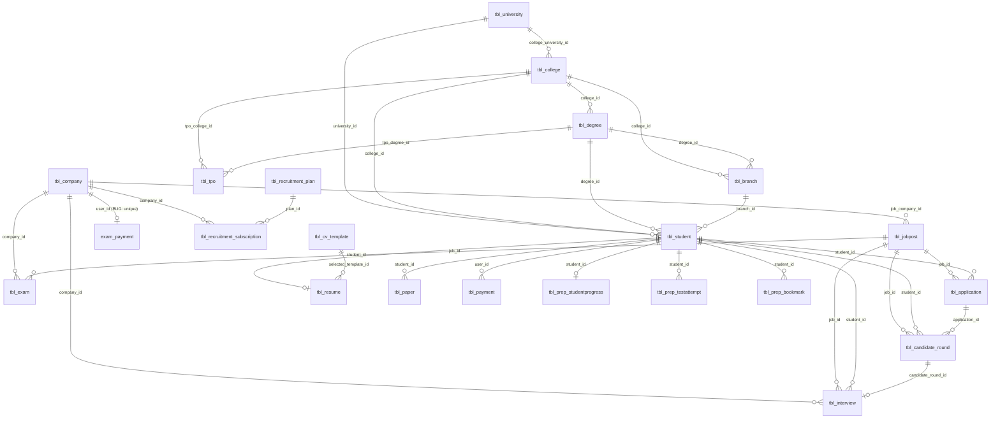
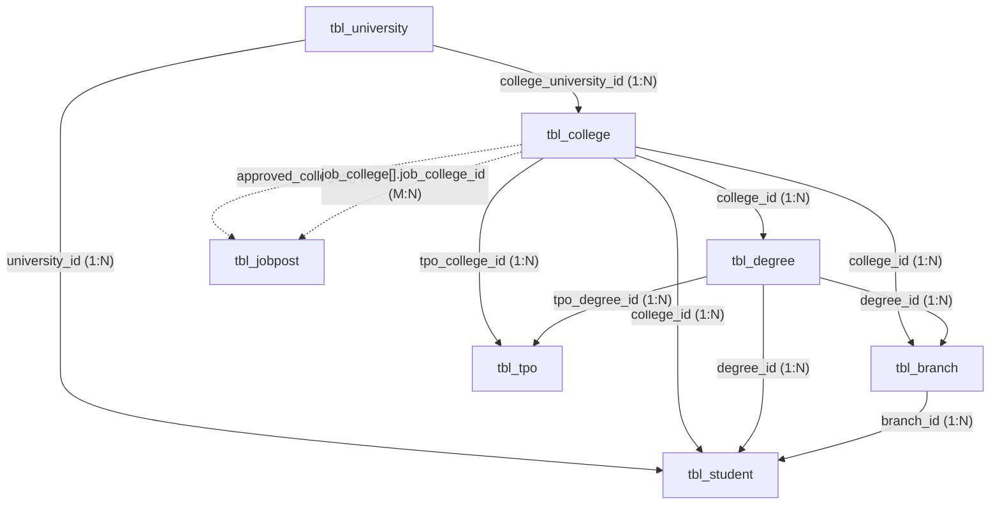
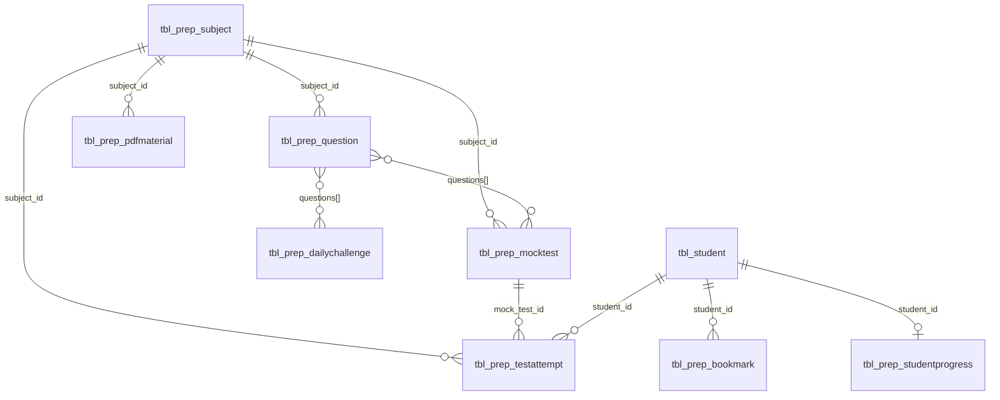
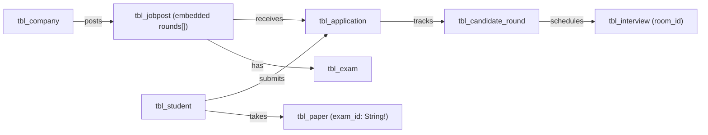

# S0-04 — Database Relationship Mapping

**Project:** The Spot Campus (`thespotcampusfinal`)  
**Total Verified Top-Level `ref` Fields:** 51 (+ nested array `ref`s in `tbl_jobpost.job_college`, `tbl_prep_studentprogress`)

---

## 1. Complete Database ER Diagram

---

## 2. College / University Relationship Diagram

---

## 3. Student & Preparation Relationship Diagram

---

## 4. Recruitment Pipeline Relationship Diagram

---

## 5. Referential Integrity Risks
- **`tbl_user` Dangling Ref (`DB-001`):** `AgentRun`, `AutoImportRule`, `JobPosting`, `JobSearch`, `JobFinderSettings` all reference `tbl_user`, which does not exist.
- **`tbl_paper.exam_id` (`DB-005`):** Typed as `String` without `ref`, storing `job_id` instead of `tbl_exam._id`.
- **Hard Deletes Without Transactions (`DB-006`):** `deleteCompany` and `deleteJob` leave orphaned `tbl_paper`, `tbl_interview`, `tbl_candidate_round` records.
