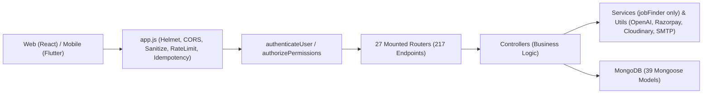
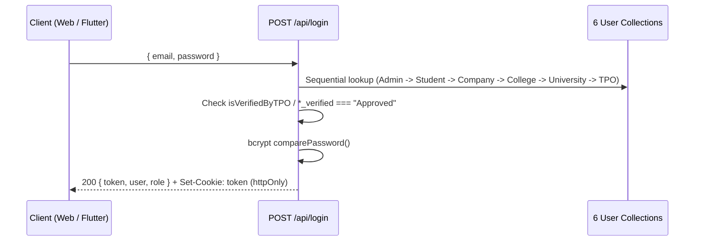
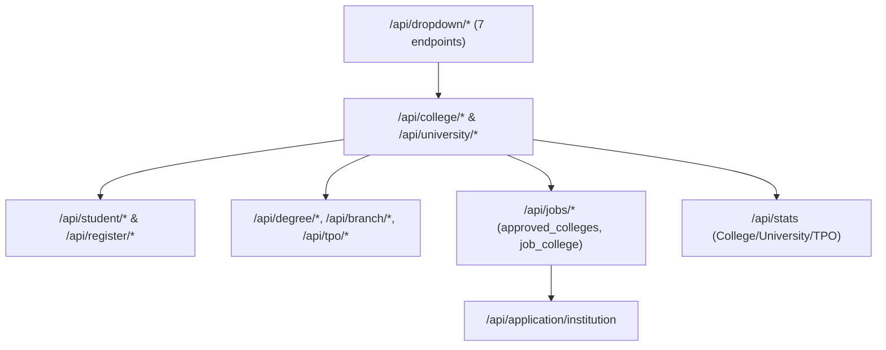

# S0-05 — Database & Business Logic Dependency Mapping

**Project:** The Spot Campus (`thespotcampusfinal`)  
**Cross-Reference:** `docs/S0-04/S0-04_API_DATABASE_MAPPING.md`, `docs/S0-04/S0-04_COLLEGE_INSTITUTE_DEPENDENCY_MAP.md`

---

## 1. API Architecture & Flow Diagrams

### A. Overall API Architecture

### B. Authentication Flow

### C. College-to-Institute API Dependency Flow

---

## 2. College-to-Institute API Dependency Summary

- **Directly Dependent API Groups (10):** `/api/university/*`, `/api/college/*`, `/api/tpo/*`, `/api/degree/*`, `/api/branch/*`, `/api/dropdown/*`, `/api/student/*` & `/api/register/*`, `/api/jobs/*`, `/api/application/*`, `/api/stats/*`.
- **Key Contract Coupling:**
  - `POST /api/jobs` & `PATCH /api/jobs/:id` accept `approved_colleges[]`, `jobEntries[]` (`job_university_id`, `job_college_id`, `job_degree_id`, `job_branch_id`), and `target_degree`.
  - `GET /api/dropdown/*` exposes `/universities`, `/colleges`, `/degrees`, `/branches`, `/colleges-by-degree`.
  - `POST /api/login` returns `role: "College"` or `"University"` (coupled to `DashboardLayout.jsx` & JWT claims).
  - **Zero `institute_id` or `/api/institute` contracts exist today.**
