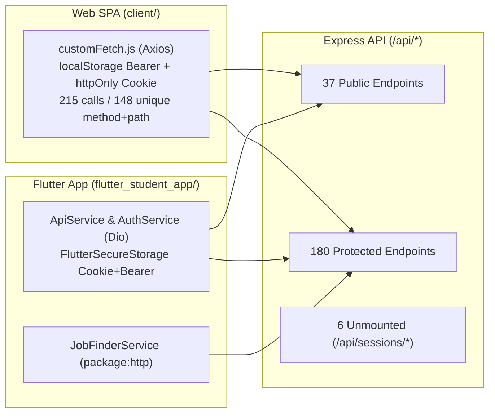

# S0-06 — API Architecture Review

**Owner:** Dev 1 | **Cross-Reference:** `docs/S0-05/*` | **Source:** `server/src/app.js`, 28 `*.route.js` files

---

## 1. Route Organization & Counts

- **30 `app.use` mounts** (covering **27 distinct `.route.js` files**; `PaymentRouter`, `StudentRouter`, `LoginRouter` mounted twice) + **4 direct `app.js` routes** = **217 mounted endpoints** (**216 unique** `METHOD + path`) + **6 unmounted** routes (`session.route.js`).
- **Method Split:** `GET: 99`, `POST: 79`, `PUT: 0`, `PATCH: 25`, `DELETE: 14`.
- **Auth Split:** `37` Public, `180` Protected (`authenticateUser`); `182` lack route-level `authorizePermissions`.

---

## 2. Backend–Web–Flutter Integration Architecture

---

## 3. Contract & Consistency Issues

- **Duplicate Mounts (`API-ISSUE-014`):** `/api/order` = `/api/payment`, `/api/register` = `/api/student` (exposing student PII publicly!), `/api/logout` = `/api/login` (`POST /api/logout` triggers login!), and `GET /api/recruitment-subscription/plans/active` defined twice.
- **Inconsistent Envelopes (`API-ISSUE-015`):** Mix of `{ msg }`, `{ error }`, `{ message }`, `{ success, data }`; controllers bypass `errorHandlerMiddleware.js` on 500s.
- **Unversioned API (`API-ISSUE-016`):** No `/api/v1` prefix; breaking changes hit Web & Flutter simultaneously.
- **Broken / Mismatched Endpoints:** `POST /api/auth/login` & `/register` validation mismatch (`API-ISSUE-010`); `GET /api/cv-templates` mutates DB on read (`API-ISSUE-017`).
