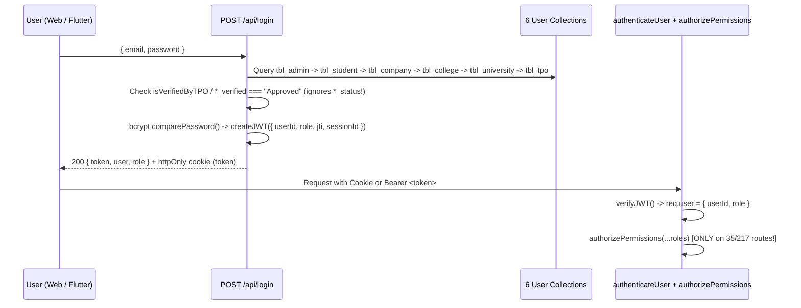

# S0-06 — Authentication & Permission Architecture

**Owner:** Dev 1 | **Baseline:** Branch `ravi`, Commit `66220d594954ba077cf1d4a709eba3a084a74abc`  
**Limitation:** The approved Step 0A Role & Permission Matrix is **not committed** in the repository; all behavior below is verified strictly from source code (`server/src/middleware/authMiddleware.js`, `login.controller.js`, `auth.controller.js`, `*.route.js`, `client/src/App.jsx`, `flutter_student_app/lib/services/auth_service.dart`).

---

## 1. Authentication & Authorization Flow (Existing — Verified)

---

## 2. Role Access Boundaries (As Implemented)

| Role | Collection | Login Gate | Backend RBAC Enforcement | Web & Flutter Enforcement |
|---|---|---|---|---|
| **Admin** | `tbl_admin` | Bcrypt only | Enforced on `preparation` writes, `college`/`company` delete+status, `jobFinder/admin/*`, `subscription` plans/all. **Missing** on `/stats/admin-report`, `/stats/transactions`, `GET /payment`, `cv-templates/admin`, `university`, `degreeMaster`. | Web sidebar hides Admin links, but `App.jsx` has **0 route guards** (`FE-001`). |
| **University** | `tbl_university` | `university_verified === "Approved"` | Scopes `getAllColleges`, `getAllStudents`, `getAllJobsClg`, `getDashboardStats`. **Bug:** `updateStudent` bypasses check (`AUD-013`). | Web only. |
| **College** | `tbl_college` | `college_verified === "Approved"` | Scopes `students`, `degrees`, `branches`, `tpos`, `applications`, `verifyStudent`. **Risk:** `updateCollege` mass assignment (`AUD-008`). | Web only. |
| **TPO** | `tbl_tpo` | Bcrypt only (`tpo_status` ignored) | Scopes by `tpo_college_id` (+ optional `tpo_degree_id`); `approveJobForCollege`, `verifyStudent`. | Web only. |
| **Company** | `tbl_company` | `company_verified === "Approved"` | Owns `jobs`, `exams`, `papers`, `interviews`. **Gaps:** `rounds` has 0 RBAC (`AUD-005`), `getAllApplications` missing ownership (`AUD-012`), `updateStudent` bypass (`AUD-013`). | Web only. |
| **Student** | `tbl_student` | `isVerifiedByTPO === true` | `requireStudentSubscription` gates `/api/preparation/*` & `POST /api/application/:id`. | Web + Flutter (Flutter lacks `role === "Student"` check on login `FL-003`). |
