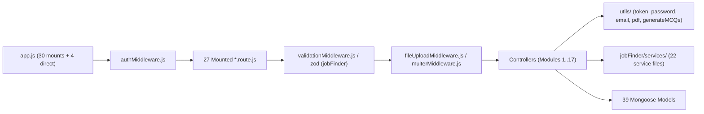

# S0-06 — Backend Architecture Review

**Owner:** Dev 1 | **Source Evidence:** `server/server.js`, `server/src/app.js`, `server/src/config/*`, `server/src/middleware/*`, `server/src/modules/*`

---

## 1. Entry Point & Initialization (`server/server.js`, `server/src/app.js`)

- `server/server.js#L1-L32` loads `dotenv` (`src/config/env.js`), registers `express-async-errors`, connects to MongoDB via `connectToMongoDB()` (`src/config/db.js`), starts HTTP + Socket.IO (`src/app.js`), and handles `SIGINT`.
- `server/src/app.js#L58-L205` configures `trust proxy`, IP port stripping, `helmet({ contentSecurityPolicy: false })`, `mongoSanitize()`, `cors`, `morgan` (dev), `/uploads` static serving (`config/uploads.js`), `cookieParser()`, `10mb` body parsers, `sanitizeInput`, rate limiters, `requireIdempotency`, **30 `app.use` route mounts + 4 direct routes**, `404` handler, `cleanupUploadOnError`, and `errorHandlerMiddleware`.

---

## 2. Backend Module Architecture (Verified)

---

## 3. Architectural Patterns & Inconsistencies

- **Dead / Duplicate Configs (`AUD-029`):**
  - `server/src/config/routes.js` (`setupRoutes`) duplicates `app.js` route mounting and is never imported.
  - `server/src/middleware/sessionSecurityMiddleware.js` (`express-session` + `connect-mongo` + `express-brute`) and `server/src/modules/session/session.route.js` (6 routes) are never mounted in `app.js`.
  - `getCurrentUser` is duplicated in `login.controller.js#L142` and `user.controller.js#L12`.
- **Dual Multer Pipelines:** `student.route.js` and `upload.route.js` use hardened `fileUploadMiddleware.js` (magic-byte checks), while 7 other modules use legacy `multerMiddleware.js`.
- **Top-Level Side Effect (`AUD-037`):** `jobFinder.controller.js#L28` runs `JobPosting.updateMany(...)` on module import.
- **No Automated Tests (`AUD-032`):** Zero test files or test runners in `server/package.json`.
