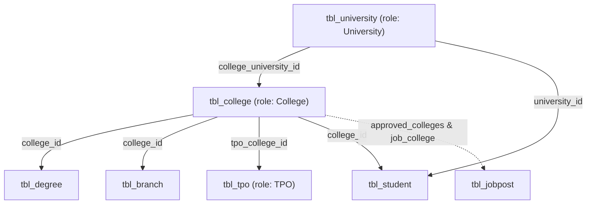
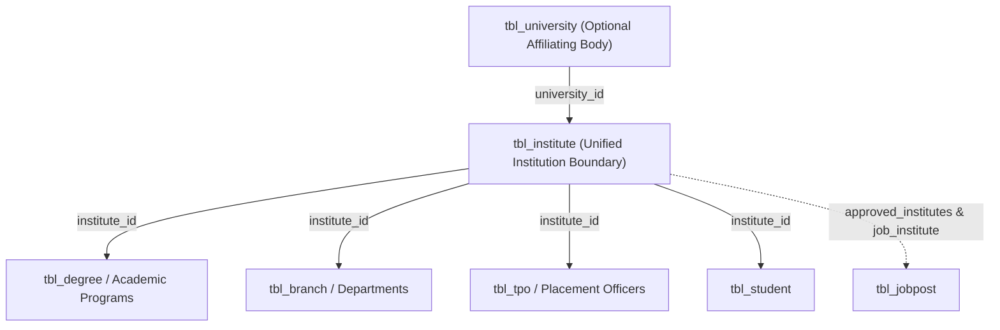

# S0-06 — College-to-Institute Future Architecture

**Owner:** Dev 1 | **Cross-Reference:** `docs/S0-04/S0-04_COLLEGE_INSTITUTE_DEPENDENCY_MAP.md`, `docs/S0-05/S0-05_API_DATABASE_BUSINESS_MAPPING.md`  
**Restriction:** Architecture planning only — zero schema, API, or UI changes performed.

---

## 1. Existing College / University Hierarchy (Verified)

---

## 2. Proposed Future Institute Architecture (Planned — Not Implemented)

---

## 3. Migration Impact & Compatibility Plan

- **Database Impact (`21` backend `.js` files, `6` models):** `tbl_college` -> `tbl_institute` (or alias), `college_id`/`tpo_college_id`/`job_college_id`/`approved_colleges` -> `institute_id` equivalents. Requires a versioned migration runner (`DB-007`) and dual-read/dual-write transition period so existing `tbl_jobpost` and `tbl_student` records remain valid.
- **API & Auth Impact (`10` route groups):** `/api/college/*`, `/api/dropdown/colleges`, JWT `role: "College"` -> `"Institute"` (must support both during transition for Web & Flutter backward compatibility).
- **Web & Flutter Impact:** `SignUpCollege.jsx`, `SignUpStudent.jsx`, `client/src/college/*`, `DashboardLayout.jsx`, and `flutter_student_app/lib/screens/register_screen.dart` all consume `college_id` and `/dropdown/colleges`. Flutter users on older app builds require API-level backward compatibility (`/api/v1` or alias fields) during rollout.
