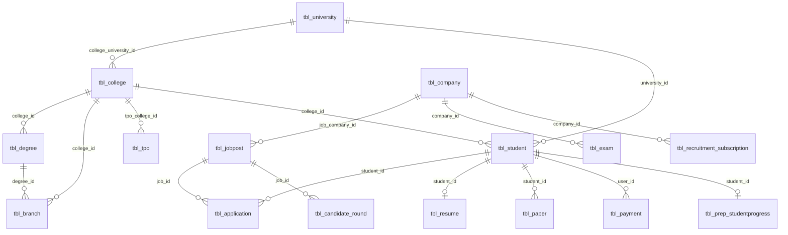

# S0-06 — Database Architecture Review

**Owner:** Dev 1 | **Cross-Reference:** `docs/S0-04/*` | **Source:** `server/src/config/db.js`, 38 `.model.js` files

---

## 1. MongoDB / Mongoose Architecture Summary

- **Engine & ODM:** MongoDB + Mongoose `^7.0.5` (`server/package.json#L34`), DNS override (`8.8.8.8`/`1.1.1.1`) + 3-retry connection in `server/src/config/db.js#L5-L52`.
- **Verified Counts:** **38** `.model.js` files → **39** Mongoose models/collections, **594** top-level schema paths, **16** embedded subdocument schemas, **51** top-level `ref` fields, **56** schema-level indexes (`schema.indexes()`).
- **Hooks, Virtuals, Transactions, Soft-Delete, Migrations:** **0** `.pre()`/`.post()` hooks, **0** `.virtual()` fields, **0** `startSession()` transactions, **0** soft-delete flags, and **0** migration scripts (`seed.js` only creates Master Admin).

---

## 2. Database Relationship Architecture (Verified)

---

## 3. Structural Database Risks

1. **Dangling `tbl_user` Ref (`DB-001`):** 5 `jobFinder` models (`AgentRun`, `AutoImportRule`, `JobPosting`, `JobSearch`, `JobFinderSettings`) reference non-existent `tbl_user`.
2. **Blocking Unique Constraint (`DB-002`):** `exampayment.model.js#L5-L10` puts `unique: true` on `user_id`, blocking repeat AI exam purchases by a company.
3. **Missing Unique & FK Indexes (`DB-003`, `DB-004`, `DB-008`):** 20 core collections have 0 custom indexes; emails and `{ student_id, job_id }` lack `unique: true`.
4. **Weak Typing (`DB-005`, `DB-009`, `DB-010`):** `tbl_paper.exam_id` is `String` (unverified ref to `tbl_exam`); dates/numbers stored as `String`; `target_degree` is `Mixed`.
5. **No Transactions (`DB-006`):** `deleteCompany`, `deleteJob`, `advanceCandidates` perform unguarded multi-collection writes.
