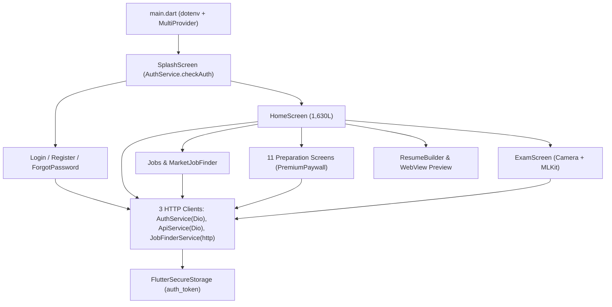

# S0-06 — Flutter Architecture Review

**Owner:** Dev 2 | **Cross-Reference:** `docs/S0-03/*` | **Source:** `flutter_student_app/lib/` (`Flutter 3.41.9`, `Dart 3.11.5`)

---

## 1. Application Structure & Navigation (`lib/main.dart`)

- **Files:** **38** `.dart` files in `lib/`: **28** `*_screen.dart` files (`27` registered in `main.dart`: `21` named `routes` + `6` `onGenerateRoute`; `1` `MarketJobDetailScreen` pushed via `MaterialPageRoute`), **4** services, **2** widgets (`GlassContainer`, `PremiumPaywall`), **1** typed model file (`market_job_models.dart`).
- **State & Storage:** `MultiProvider` (`AuthService` `ChangeNotifier` + `ApiService`), local `StatefulWidget` state, `FlutterSecureStorage` (`auth_token`), `SharedPreferences` (streak only).
- **Platform Features:** Native `camera` + `google_mlkit_face_detection` in `exam_screen.dart` (1,394L), `razorpay_flutter` in `plans_screen.dart`, `webview_flutter` + `flutter_pdfview` for CV/PDFs.

---

## 2. Flutter Architecture (Verified)

---

## 3. Web vs. Flutter Feature Parity & Architectural Gaps

- **Both Platforms (Student):** Auth, Profile, Jobs, Market Job Finder, Applications, AI CV Builder, Preparation (11 modules), Razorpay Plans, Proctored Exams.
- **Web Only (Intentionally):** Admin, Company, College, University, TPO portals; Reset Password page; Exam Result summary (`FL-019` missing in Flutter).
- **Flutter-Specific Gaps:**
  - **3 Fragmented HTTP Clients (`FL-008`):** `JobFinderService` uses `package:http` without timeouts.
  - **Broken Interview Link (`FL-005`):** `interview_list_screen.dart#L54` strips `/api` from API `baseUrl` instead of web client URL.
  - **Cleartext HTTP (`FL-001`, `FL-022`) & No Student Role Guard (`FL-003`).**
  - **Unused Heavy Dependencies (`FL-011`):** `socket_io_client` & `flutter_local_notifications` have 0 imports.
  - **Zero Automated Tests (`FL-009`).**
