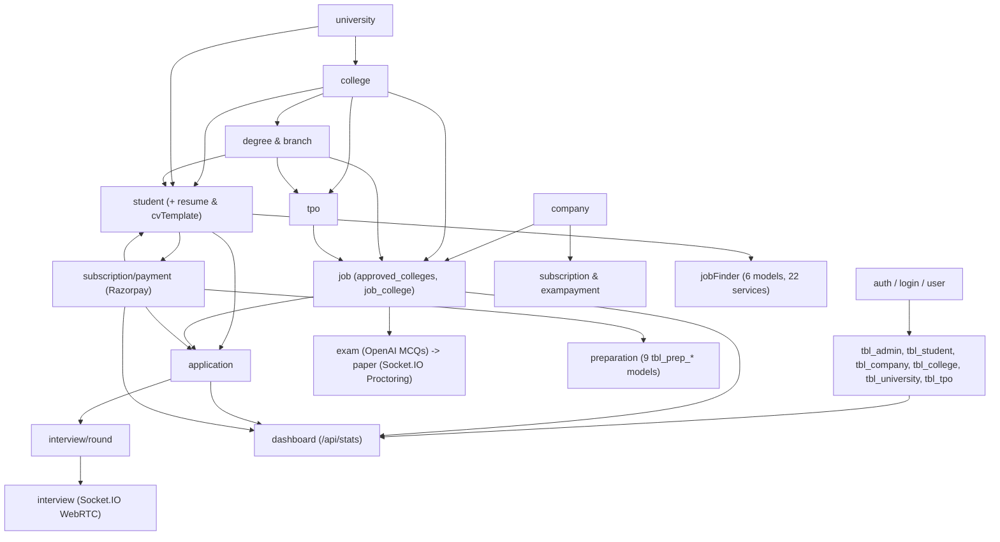

# S0-06 — Module Dependency Mapping

**Owner:** Dev 1 + Joint | **Scope:** All 17 existing backend domain modules + 4 support modules (`dashboard`, `contact`, `upload`, `idempotency`)

---

## 1. Major Module Dependency Architecture (Verified)

---

## 2. Module Coupling & Boundary Observations

- **Highest Fan-In (Most Depended-Upon) Modules:** `student` (depended on by `auth`, `application`, `exam/paper`, `interview`, `preparation`, `subscription/payment`, `dashboard`), `college` (depended on by `university`, `tpo`, `degree`, `branch`, `student`, `job`, `application`, `dashboard`), and `job` (depended on by `application`, `exam`, `interview`, `round`, `dashboard`).
- **Isolated / Loosely Coupled Modules:** `contact` (`tbl_contact`), `idempotency` (`tbl_idempotency_key`), `upload`, and `jobFinder` (self-contained `services/` + `models/`, though `jobFinder` models have dangling `ref: 'tbl_user'` `DB-001`).
- **Planned / Unimplemented Modules:** `session` (`session.route.js` + `sessionSecurityMiddleware.js` exist but are unmounted/dead); `Institute` (does not exist yet — planned for College-to-Institute migration).
