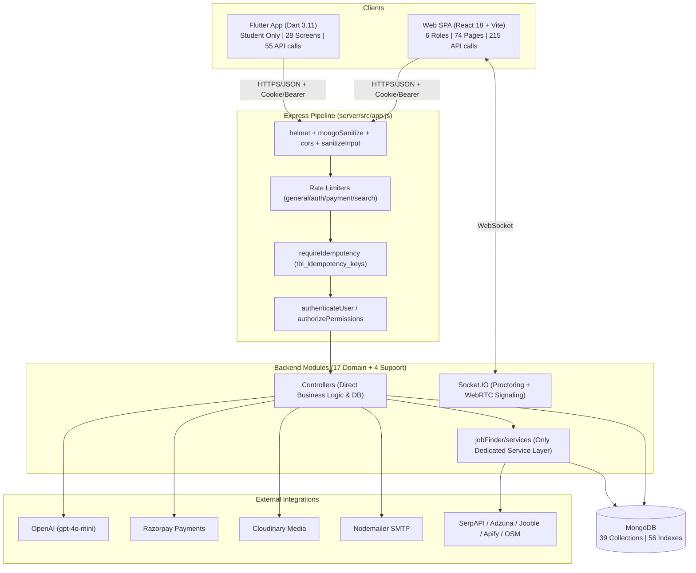

# S0-06 — System Architecture Overview

**Project:** The Spot Campus (`thespotcampusfinal`)  
**Owner:** Dev 1 (with Joint System Flow) | **Baseline:** Branch `ravi`, Commit `66220d594954ba077cf1d4a709eba3a084a74abc`  
**Status:** Architecture Review Only (No Code Modified)

---

## 1. Platform Topology

The Spot Campus is a **three-tier multi-client platform**:
1. **Web Frontend (`client/`):** React `18.3.1` + Vite `6.3.5` + Tailwind CSS `3.4.4` SPA serving all **6 roles** (`Admin`, `University`, `College`, `TPO`, `Company`, `Student`) across `74` page files and `67` routes (`client/src/App.jsx`).
2. **Flutter Mobile App (`flutter_student_app/`):** Flutter `3.41.9` / Dart `3.11.5` mobile app serving the **Student** role (`28` screens, `27` routes in `lib/main.dart` + `1` `MaterialPageRoute`, native Camera + Google MLKit proctoring).
3. **Backend API & Real-Time Server (`server/`):** Node.js `v22.23.5` + Express `4.18.2` modular monolith + Socket.IO `4.7.5` (`server/src/app.js`, `server/src/config/socket.js`) backed by **MongoDB** (Mongoose `7.0.5`, `39` models).

---

## 2. Overall System Architecture (Existing — Verified)

---

## 3. End-to-End Request Flow & Deviations

- **Intended Flow:** `User → Web/Flutter → Route → Middleware (Auth/RBAC/Validation) → Controller → Service → Database → Error/Response`.
- **Verified Deviations:**
  1. **Missing Service Layer:** 16 of 17 domain modules place business logic and Mongoose queries directly inside controllers (only `jobFinder` uses a `services/` layer).
  2. **Inconsistent Auth/RBAC:** 5 public/unprotected route groups (`auth/register`, `university`, `degreeMaster`, `register`, `contact`) and 182/217 mounted routes lack route-level `authorizePermissions` (`S0-05`).
  3. **Bypassed Error Middleware:** Many controllers catch errors and return `res.status(500).json({ error: err.message })` directly instead of delegating to `errorHandlerMiddleware.js`.
