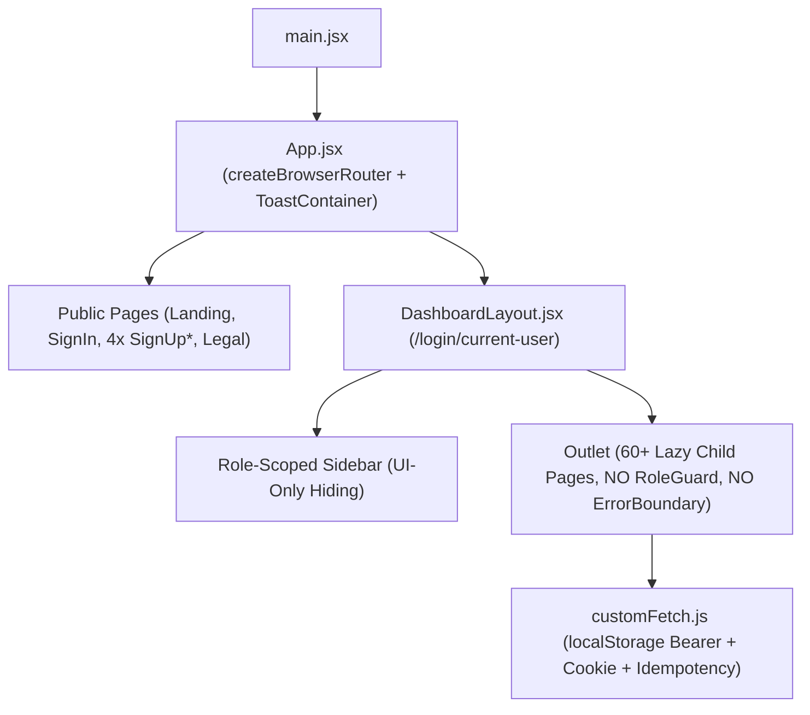

# S0-06 — Web Frontend Architecture Review

**Owner:** Dev 2 | **Cross-Reference:** `docs/S0-02/*` | **Source:** `client/src/` (`React 18.3.1`, `Vite 6.3.5`, `Tailwind 3.4.4`)

---

## 1. Application Structure & Routing (`client/src/App.jsx`)

- **Pages & Routes:** **74** page files (`72` active/layout-rendered, `2` unrouted: `company/pages/RecruitmentSubscription.jsx`, `university/pages/ManageBranch.jsx`), **67** routes in `App.jsx` (`12` top-level + `/dashboard` + `54` child routes) using `React.lazy` + `Suspense`.
- **Components:** **27** component files (`12` `common/components/`, `8` `admin/components/`, `3` `college/`, `2` `company/`, `2` `university/` including unused `AddBranchModal.jsx`).
- **State & Data Fetching:** No Redux/React Query (contrary to `README.md`). `DashboardLayout.jsx` fetches `/login/current-user` and passes `{ user, role, reloadUser }` via `<Outlet context>`. `customFetch.js` provides Axios + 3s `Idempotency-Key` cache.

---

## 2. Web Frontend Architecture (Verified)

---

## 3. Key Web Architectural Gaps

- **Zero Route-Level Role Guards (`FE-001`):** Any authenticated user can navigate to any role's `/dashboard/*` URL.
- **`localStorage` JWT Exposure (`FE-002`) & Missing `401` Redirect (`FE-004`):** Exposes JWT to XSS and leaves stale UI on session expiry.
- **No `ErrorBoundary` (`FE-009`):** Uncaught render errors crash the SPA.
- **Duplication & Monoliths (`FE-010`, `FE-012`):** `ManageStudent` (4x), `ManageJob` (4x), `ManageDegree` (2x) are duplicated across roles; 5 pages exceed 950–1,954 lines; `DataTable.jsx` lacks pagination (`FE-011`).
- **Zero Automated Tests (`FE-017`).**
