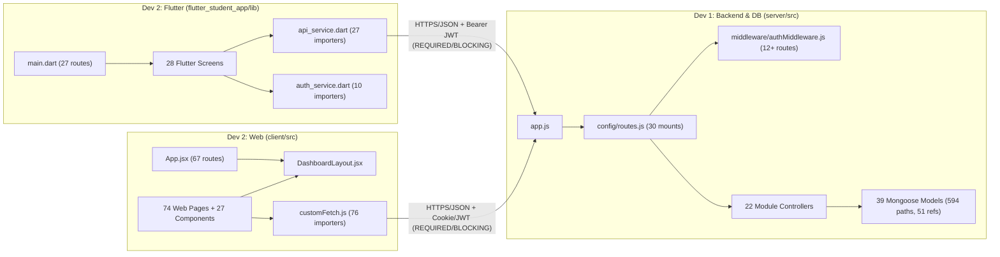

# S0-09 — Complete File Dependency Map

**Project:** The Spot Campus (`thespotcampusfinal`) | **Baseline:** Branch `ravi` (`66220d594954ba077cf1d4a709eba3a084a74abc`)

---

## 1. Cross-Platform System Dependency Graph

---

## 2. Example Deep File Dependency Trace (`FEAT-011` Student Profile)
- **Backend (Dev 1):** `student.route.js` -> `authMiddleware.js` (`BLOCKING`) + `validationMiddleware.js` (`REQUIRED`) -> `student.controller.js` -> `student.model.js` (`BLOCKING`) + `tpo.model.js` (`REQUIRED` cross-module).
- **Web (Dev 2):** `Profile.jsx` -> `customFetch.js` (`BLOCKING`) + `PageHeader.jsx` (`REQUIRED`) + `Loading.jsx` (`REQUIRED`).
- **Flutter (Dev 2):** `profile_screen.dart` -> `api_service.dart` (`BLOCKING`) + `auth_service.dart` (`REQUIRED`).
